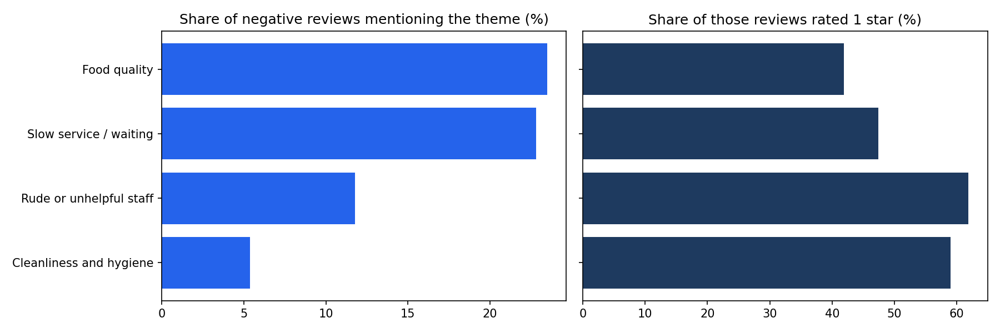

# Customer Complaint Analysis: What Makes Customers Unhappy?

## Business question
Local businesses collect thousands of reviews but cannot read them all. Across about 11,500 Phoenix-area businesses (restaurants, bars, shops and services), what do unhappy customers complain about most, which complaints make them angriest, and where should an operator focus first?

## Data
Yelp Phoenix Academic Dataset (training review file) from the Kaggle "RecSys Challenge 2013: Yelp business rating prediction" competition: https://www.kaggle.com/c/yelp-recsys-2013
Used under the academic dataset terms of use. The raw data is not included in this repo. To run the notebook, download the file from Kaggle, upload it to Google Drive and set its path in the first cell.

## Methods used
Text cleaning, tokenization, stop-word handling (negations kept), lemmatization, bag of words, n-grams, TF-IDF, sentiment classification (Logistic Regression), topic modelling (LDA), keyword-based theme extraction, logistic regression for complaint severity.

## What I did
- Cleaned 229,907 reviews (2005-2013): removed 6 empty reviews and 242 duplicates, leaving 229,659 reviews from 11,537 businesses and 45,980 reviewers.
- Built a text classifier (TF-IDF + Logistic Regression) that detects negative (1-2 star) reviews. It flags **92% of truly negative reviews** (recall) with 93.5% accuracy on 38,865 unseen reviews. For reference, always guessing "positive" would give 80.2% accuracy. Negation words such as "not" and "never" were kept, because "not good" means the opposite of "good".
- The classifier shows that review text alone can identify unhappy customers, which is useful where there is no star rating (survey comments, support emails, chat). The theme analysis then uses 1-2 star reviews as the labelled set.
- Used topic modelling (LDA) on the 38,398 negative reviews to explore what they talk about. The topics were mixed because the data covers many business types, so I used keyword rules to measure the main complaint themes.
- Checked the keyword rules by hand: 27 of 32 randomly sampled reviews (8 per theme) matched their theme.
- Measured how common each complaint is, how often it appears in 1-star reviews, and how it changed by year.

## Results

| Complaint theme | Share of negative reviews | Share that are 1-star | Effect on 1-star odds* |
|---|---|---|---|
| Food quality | 23.5% | 41.9% | 0.85x |
| Slow service / waiting | 22.8% | 47.4% | 1.06x |
| Rude or unhelpful staff | 11.8% | 61.8% | 2.08x |
| Cleanliness and hygiene | 5.4% | 59.0% | 1.79x |

*From a logistic regression on the four themes, among negative reviews. About 45.5% of all negative reviews are 1-star. This shows association, not cause.

## Key findings
1. Food quality and slow service are the most common complaints (about a quarter of negative reviews each).
2. Rude staff and dirty conditions are less common but far more severe: 62% and 59% of those reviews are 1-star, and they make a 1-star review about 2.1x and 1.8x as likely.
3. Slow service is common but does not make reviews noticeably angrier on its own (odds ratio about 1.06).
4. Rude-staff complaints rose from 8.9% of negative reviews in 2008 to 13.8% in 2012. Slow service stayed flat (about 22-23%).

## Recommendation
These are market-wide patterns, not advice for one specific business. An individual operator should run the same analysis on their own reviews before acting.
- **Fix first, by volume:** waiting times and food quality, because they affect the most customers (staffing at peak times, quoted wait times, kitchen quality checks).
- **Fix first, by severity:** staff conduct and cleanliness, because they turn unhappy customers into angry ones (service-recovery training, regular hygiene audits).
- **How I would test it:** pilot the change in a few locations and compare the share of 1-2 star reviews mentioning the theme against similar locations without it. This is a proposed test design; I did not run it.

## Limitations
- The data covers the Phoenix, Arizona area only and is old (2005-2013), so results may not apply elsewhere or today.
- The review file has no business category, so I could not compare restaurants with shops or services. Food quality applies mainly to food businesses.
- The theme rules are keyword-based and approximate. They matched 27 of 32 sampled reviews, so the shares are best read as rough size, not exact counts.
- 49.6% of negative reviews match none of the four themes, and a review can belong to more than one theme.
- The classifier wrongly flags some positive reviews as negative (precision for negative reviews is 79%), and it misses mild or mixed negative reviews.
- Findings show association, not cause.

## Files
- `customer_complaint_analysis.ipynb`: the full analysis (cleaning, exploration, model, themes)
- `complaint_themes.png`: the main chart
- `DECISIONS.md`: why I made each choice

Tools: Python, pandas, scikit-learn, NLTK, matplotlib.# customer-complaint-analysis

